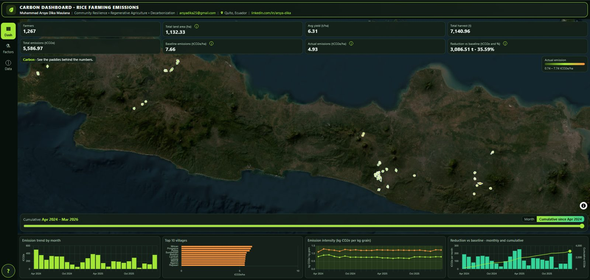

# Carbon Dashboard · Rice Farming Emissions

**Explore the live dashboard: https://arsyadika.github.io/Carbon-Emissions-Dashboard/**

No installation or login required. Open the link and start exploring.

[](https://arsyadika.github.io/Carbon-Emissions-Dashboard/)

## Overview

Rice paddies are a major source of methane and nitrous oxide, yet their emissions are hard to see and compare. This dashboard turns farm-level records into a clear, village-level picture of greenhouse gas emissions from rice farming across **39 villages in Java, Indonesia**, from **April 2024 to March 2026**.

## Headline results

| Indicator | Value |
|---|---|
| Farmers covered | 1,267 |
| Land area | 1,132 ha |
| Baseline emissions | 7.66 tCO2e/ha |
| Actual emissions | 4.93 tCO2e/ha |
| Reduction vs. baseline | 3,086 tCO2e, or 35.6% |

## What the dashboard offers

- **Interactive map:** village polygons on a satellite basemap, coloured by actual emissions per hectare. Villages without data stay uncoloured and are never shown as zero.
- **Key indicators:** farmers, land area, average yield, harvest, total emissions, baseline and actual emissions per hectare, and the reduction achieved.
- **Four linked charts:** monthly emission trend, top 10 villages, emission intensity (kg CO2e per kg of grain), and reduction vs. baseline by month and cumulative.
- **Time control:** switch between a single month and the cumulative total since April 2024.
- **Factors tab:** fertilizer inputs per village, compared between Baseline and Actual practice.
- **Data tab:** clear definitions of every metric, with a live worked example.
- **Built-in guide:** the `?` button opens a short walkthrough and important notes on the data.

## Methodology

- **Actual emissions:** estimated emissions for fields harvested in the period, based on recorded farming practices.
- **Baseline emissions:** expected emissions under conventional practice before the programme (baseline survey in 2021, endline in 2023, with IRRI).
- **Reduction:** Baseline minus Actual.
- Ratios (tCO2e/ha, yield, reduction %) are recomputed from totals rather than averaged across months, and each farmer is counted once.

## Data and privacy

Data comes from two anonymised sources ("source A" and "source B") and is published only as village-level aggregates. No farmer-level or personal data is included.

## Technical approach

- A fully static site (HTML, CSS and ES modules) built on [MapLibre GL JS](https://maplibre.org/) and [Chart.js](https://www.chartjs.org/). It needs no server or database, so it loads fast and is simple to host.
- Data is prepared offline with Python and shipped as static files in `data/`: `villages.geojson`, `meta.json` and `factors.json`.

```
index.html      page structure
style.css       styling
src/            JavaScript modules (map, charts, indicators, tabs, guide)
data/           village polygons, monthly series, fertilizer factors
assets/         images
```

## Run locally

Any static server works, for example:

```
python -m http.server 8000
```

Then open http://localhost:8000. An internet connection is needed because MapLibre and Chart.js load from a CDN.

## Credits

Basemap imagery © Esri and its data providers. Village boundaries from an official ArcGIS REST service and OpenStreetMap contributors (ODbL). Map rendering by MapLibre GL JS and charts by Chart.js.

## Author

**Muhammad Arsya Dika Maulana**: Community Resilience · Regenerative Agriculture · Decarbonization
[linkedin.com/in/arsya-dika](https://www.linkedin.com/in/arsya-dika)
